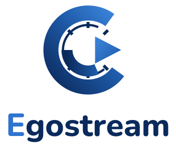
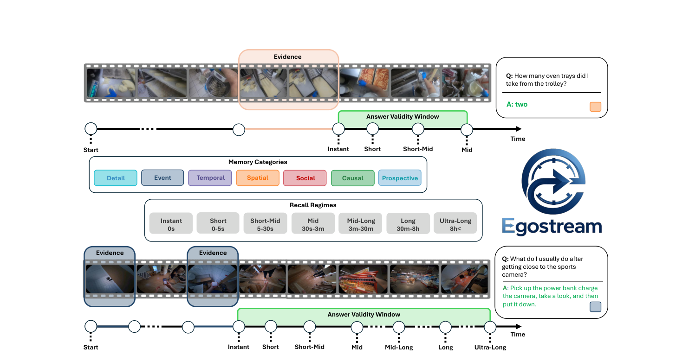

<p align="center">
  <picture>
    <source media="(prefers-color-scheme: dark)" srcset="docs/assets/egostream-logo-dark.svg">
    
  </picture>
</p>

# EgoStream: A Diagnostic Benchmark for Streaming Episodic Memory in Egocentric Vision

[Rosario Forte](https://coai-iplab.github.io/team/rosario_forte), [Giuseppe Lando](https://coai-iplab.github.io/team/giuseppe_lando), [Antonino Furnari](https://antoninofurnari.github.io) · University of Catania

**NeurIPS 2026, Track on Evaluations and Datasets** · [Paper (arXiv)](https://arxiv.org/abs/2605.31557) · [Project page](https://coai-iplab.github.io/EgoStream/)

EgoStream measures *what* a streaming multimodal LLM remembers from a first-person video
stream and *for how long*. 2,250 curated questions over seven memory dimensions (detail,
spatial, temporal, event, social, causal, prospective) are expanded into 8,528
recall-conditioned evaluations through the **Answer Validity Window (AVW)**, which separates
genuine forgetting from natural scene changes.

This repository contains the **unified streaming framework** used in the paper: one
KV-cache implementation that exposes the same streaming interface to every memory policy
(sliding window, attention sinks, token pruning, token merging, adaptive head budgets,
offloading and quantized offloading, pre-prefill compression) on three backbones
(Qwen3-VL-8B, InternVL 3.5-8B, Molmo 2-8B).

<p align="center">
  
</p>

## What is in this release

| Component | Status |
|---|---|
| Streaming inference framework, all memory policies, three backbones | released (this repository) |
| Run configurations for every row of Tables 4, 5, 6 and 11 | released (`configs/`) |
| Evaluation script (accuracy per semantic category and recall regime) | released (`evaluate.py`) |
| Data download and clip reconstruction scripts | released (`data/download/`) |
| Question annotations (2,250 questions / 8,528 evaluations) | **coming soon** (`data/annotations/`) |
| Project page | `docs/` (served with GitHub Pages) |

Videos are never redistributed: see [`data/README.md`](data/README.md) for how to obtain
them from the five source datasets.

## Repository layout

```text
EgoStream/
├── run_benchmark.py               # full benchmark; picks the backbone from the config
├── run_benchmark_qwen3vl.py       #   Qwen3-VL implementation
├── run_benchmark_internvl35.py    #   InternVL 3.5 implementation
├── run_benchmark_molmo2.py        #   Molmo 2 implementation
├── run_single_video.py            # stream one video and ask one question (any backbone)
├── evaluate.py                    # aggregates predictions into accuracy tables
├── src/                           # model loading, streaming ingestion, generation, STC pruner
├── Caches/                        # FlexibleCache: sink / mutable / hat regions, reducers,
│                                  # Ada-KV, disk offloading, ReKV-style retrieval
├── configs/                       # one JSON per paper row + configuration guide
├── prompts/ingestion_prompt.txt   # ingestion prompt (Appendix A.7)
├── scripts/                       # config generators, output re-bucketing
├── data/                          # download scripts, annotation placeholder, sample video
└── docs/                          # project page (static HTML)
```

## Installation

Tested with Python 3.11, CUDA 12.4 and a single NVIDIA A100 (64 GB).

```bash
git clone https://github.com/coai-iplab/EgoStream.git
cd EgoStream
python -m venv .venv && source .venv/bin/activate
pip install --upgrade pip
pip install -r requirements.txt
```

`requirements.txt` pins `torch==2.6.0` and `transformers==4.57.1`: the cache code patches
model internals and is only validated against these versions. On Windows install the CUDA
build of torch first (`pip install torch==2.6.0 torchvision==0.21.0 --index-url
https://download.pytorch.org/whl/cu124`), then the requirements.

**Flash Attention (optional).** All runners try `flash_attention_2` first and fall back to
PyTorch SDPA when it is not installed. To reproduce the reported timings install the wheel
matching your platform, for example:

```bash
pip install https://github.com/Dao-AILab/flash-attention/releases/download/v2.7.4.post1/flash_attn-2.7.4.post1+cu12torch2.6cxx11abiFALSE-cp311-cp311-linux_x86_64.whl
```

Set `QWEN_DISABLE_FLASH_ATTN=1` to force the SDPA path even when flash-attn is installed.

**Models.** Weights are downloaded from the Hugging Face Hub on first use into `HF_HOME`
(default `~/.cache/huggingface`). Molmo 2 is loaded with `trust_remote_code=True`.

| Backbone | `model.model_id` |
|---|---|
| Qwen3-VL-8B (main experiments) | `Qwen/Qwen3-VL-8B-Instruct` |
| InternVL 3.5-8B | `OpenGVLab/InternVL3_5-8B-HF` |
| Molmo 2-8B | `allenai/Molmo2-8B` |

## Quick start: one video, one question

Copy any egocentric `.mp4` to `data/sample/sample_video.mp4` (or edit `paths.video_path` in
the config), then run:

```bash
python run_single_video.py --config configs/single_video/qwen3vl_8b_prune_intra_cs.json
```

The script reads the backbone from `model.model_id`, primes the cache with the ingestion
prompt, streams the video at 1 FPS through the configured memory policy and answers
`single_video_test.question`. Other presets in `configs/single_video/`:
`internvl3_5_8b_*.json`, `molmo2_8b_*.json`, `qwen3vl_8b_adakv.json`, `qwen3vl_8b_stc.json`
and the `qwen3vl_2b_*.json` variants for small GPUs. Add `--fast` for a two-frame smoke
test. Paths inside single-video configs are resolved relative to the config file.

**Smoke test on a small GPU.** `configs/single_video/smoke/` runs every memory policy
(FIFO, pruning, merging, pipeline, int8 offloading with retrieval, Ada-KV, STC) on
Qwen3-VL-2B with a 1,024-token budget and 4-frame windows, so that memory management
triggers even on a 15-second clip. Each run takes well under a minute on an 8 GB laptop GPU:

```bash
for c in configs/single_video/smoke/qwen3vl_2b_*.json; do python run_single_video.py --config "$c" --max-new-tokens 48; done
```

## Running the benchmark

1. **Annotations.** Place the EgoStream annotation file at
   `data/annotations/egostream_annotations.json` (release pending, see
   [`data/annotations/README.md`](data/annotations/README.md)).
2. **Videos.** Follow [`data/README.md`](data/README.md). The download script writes the
   trimmed clips and an `all_annotations.json` with resolved video paths; point
   `paths.annotations_file` and `paths.clip_base_path` of the configs to that folder.
3. **Run** from the repository root (paths in benchmark configs are relative to it):

```bash
python run_benchmark.py --config configs/qwen3vl_8b/t4_r11_prune_intra_cos.json
```

`run_benchmark.py` selects the implementation from `model.model_id` (Qwen3-VL, InternVL
3.5 or Molmo 2) and forwards every other argument to it; the backbone-specific runners can
also be called directly. Ada-KV and STC are available for Qwen3-VL only and the run stops
with an explicit error otherwise.

**Parallel runs.** Every runner shards the videos across processes with
`--rank i --world_size N` (one GPU per process, for example one Slurm job-array task per
rank). Predictions are written to `outputs/<config name>/part_<rank>.json` and runs resume
from existing parts; `scripts/rebucket_outputs.py` re-shards existing parts when the world
size changes.

**Protocol** (Appendix C.1): 1 FPS, frames resized to 896x512, sliding window of 16 frames
with stride 16, temperature 0.01, top-p 0.9, options shuffled once with seed 42. The default
budget is 8,192 mutable tokens plus the sink (system prompt) and hat (two most recent
frames) regions, i.e. the 9,804-token budget of the paper.

## Evaluation

```bash
python evaluate.py --inference-root outputs --annotations data/annotations/egostream_annotations.json
```

The script reads every `outputs/<experiment>/part_*.json`, scores the 4-way multiple-choice
answers and writes `outputs/evaluation_summary.xlsx` with accuracy per semantic category
(SPAT, TEMP, DETL, EVNT, SOC, CAUS, PROS) and per recall regime (instant, short, short-mid,
mid, mid-long, long, ultra-long), plus the macro averages and per-frame processing time.

## Memory policies and paper tables

Each paper row has a config. Names follow `t<table>_r<row>_<policy>`; literature
equivalents are given as in Table 4.

**Table 4, Qwen3-VL-8B, 9,804-token budget** (`configs/qwen3vl_8b/`)

| Row | Policy | Literature | Config |
|---:|---|---|---|
| 1 | FIFO | sliding window | `t4_r01_fifo` |
| 2 | FIFO + SINK | StreamingVLM | `t4_r02_fifo_sink_streamingvlm` |
| 3 | MERGE INTRA-PA | CaM-like | `t4_r03_merge_intra_pa_cam` |
| 4 | MERGE INTRA-COS | CaM-like | `t4_r04_merge_intra_cos_cam` |
| 5 | MERGE INTRA-PA + PRUNE INTER-PA | hybrid | `t4_r05_merge_intra_pa_prune_inter_pa` |
| 6 | PRUNE INTRA-CS | StreamMem | `t4_r06_prune_intra_cs_streammem` |
| 7 | PRUNE INTRA-VN | InfiniPot-V (VaN) | `t4_r07_prune_intra_vn_infinipot` |
| 8 | PRUNE INTRA-VN + INTER-COS | InfiniPot-V (TaR) | `t4_r08_prune_intra_vn_inter_cos_infinipot` |
| 9 | PRUNE INTRA-PA + INTER-PA | InfiniPot-V | `t4_r09_prune_intra_pa_inter_pa_infinipot` |
| 10 | PRUNE INTRA-PA + INTER-COS | StreamingTOM (no Q-OFF) | `t4_r10_prune_intra_pa_inter_cos_streamingtom` |
| 11 | PRUNE INTRA-COS | | `t4_r11_prune_intra_cos` |
| 12 | PRUNE INTRA-PA | | `t4_r12_prune_intra_pa` |
| 13 | PRUNE INTER-PA | | `t4_r13_prune_inter_pa` |
| 14 | PRUNE INTER-COS | | `t4_r14_prune_inter_cos` |
| 15 | PRUNE INTRA-VN + INTER-PA | | `t4_r15_prune_intra_vn_inter_pa` |
| 16 | PRUNE INTRA-CS + INTER-PA | | `t4_r16_prune_intra_cs_inter_pa` |
| 17 | PRUNE INTRA-PA + INTER-COS, no HAT | StreamingTOM (no Q-OFF) | `t4_r17_prune_intra_pa_inter_cos_nohat` |
| 18 | ADA-HEAD | Ada-KV | `t4_r18_adakv_adahead` |
| 19 | OFFLOAD | ReKV | `t4_r19_offload_rekv` |
| 20 | Q-OFF | ReKV, int8 offload | `t4_r20_qoff_rekv_int8` |
| 21 | PRUNE INTRA-PA + INTER-COS + Q-OFF | StreamingTOM | `t4_r21_prune_intra_pa_inter_cos_qoff_streamingtom` |

`base_fifo_sink_hat` is the FIFO + SINK + HAT baseline shared by rows 6 to 21.

**Table 5, memory budgets** (`configs/qwen3vl_8b/budgets/`): the row-10 policy with
`mutable_token_size` in {1024, 2048, 4096, 8192, 16384, 32768, 49152}; adding the ~1,612
sink and hat tokens gives the 2,636 to 50,764 token budgets of the table.

**Table 6, backbones** (`configs/internvl3_5_8b/`, `configs/molmo2_8b/`): intra-frame
pruning and merging with the cosine and pseudo-attention scorers, `t6_r05` to `t6_r12`.
Rows 1 to 4 (Qwen3-VL) are `t4_r11`, `t4_r12`, `t4_r04` and `t4_r03`. The `extra_*` configs
are additional policies run on these backbones with the same protocol.

**Table 11, pre-prefill compression**: `t11_fifo_sink_hat_stc` (STC-Pruner on top of
FIFO + SINK + HAT).

New policies are composed in JSON. [`configs/README.md`](configs/README.md) explains the
config section by section with one recipe per policy (pruning, merging, pipelines,
offloading and retrieval, Ada-KV, STC) and how the backbone is chosen;
[`configs/REFERENCE.md`](configs/REFERENCE.md) lists every field.
`scripts/create_adakv_config_from_baseline.py` and
`scripts/create_stc_config_from_baseline.py` derive Ada-KV and STC variants from any
baseline config.

## Citation

```bibtex
@inproceedings{forte2026egostream,
  title     = {EgoStream: A Diagnostic Benchmark for Streaming Episodic Memory in Egocentric Vision},
  author    = {Forte, Rosario and Lando, Giuseppe and Furnari, Antonino},
  booktitle = {Advances in Neural Information Processing Systems (NeurIPS), Track on Evaluations and Datasets},
  year      = {2026}
}
```

## License

The code is released under the MIT License (see [`LICENSE`](LICENSE)). The annotations and
the source video datasets (Ego4D, EgoLife, EgoTempo, Multi-Hop EgoQA, HD-EPIC) are subject
to their own licenses and access agreements.

## Acknowledgements

We acknowledge ISCRA for awarding this project access to the LEONARDO supercomputer, owned
by the EuroHPC Joint Undertaking and hosted by CINECA (Italy). We thank Giulio Pedicone,
Michela Maria Tasca and Emanuele Galiano for their contribution to the data validation.
