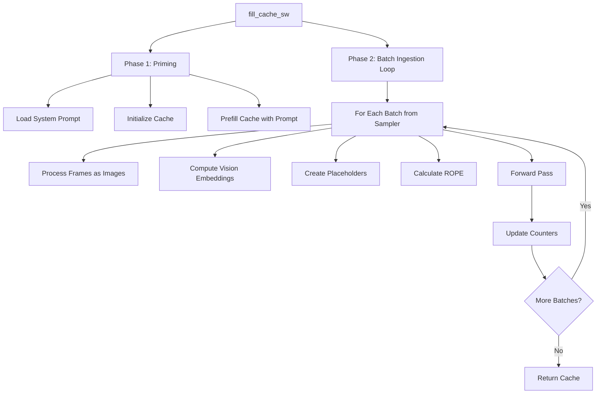

# Cache Filling Flow: Step-by-Step Walkthrough

This document provides a line-by-line walkthrough of the [`fill_cache_sw`](file:///home/rforte/nas_home/OEM-VQA/ECCV/src/model_operations.py#L131-L321) function.

## Function Signature

```python
def fill_cache_sw(sampler, model, processor, cache_cfg, prompt_path, size=(360, 240)):
    """
    Sliding Window version treating batch as SEQUENCE OF IMAGES.
    This mimics the working frame-by-frame logic but processes N frames in one forward pass.
    """
```

## High-Level Structure



---

## Phase 1: Priming (Lines 131-207)

### Purpose
Initialize the cache with the system prompt to establish context before video ingestion.

### Code Walkthrough

#### Lines 131-142: Import Dependencies
```python
from .tensor_ops import (
    process_pil_image, compute_visual_embeddings,
    compute_projected_embeddings, compute_text_embeddings,
    replace_placeholder
)
from .utils import resize_video_frame
```

**Why**: We use the **standard** tensor operations (not `_sw` versions) because we process frames as individual images.

#### Lines 147-151: Load System Prompt
```python
print("DEBUG: Starting Priming Phase...", flush=True)

with open(prompt_path, 'r') as f:
    prompt_content = f.read()
```

**What**: Reads the system prompt file (e.g., `template_questions_Ego4D.txt`)

**Example prompt**:
```
You are a helpful assistant that analyzes videos and answers questions about them.
Pay attention to all details in the video frames you will see.
```

#### Lines 152-158: Create Priming Conversation
```python
priming_conversation = [
    {"role": "system", "content": [{" type": "text", "text": prompt_content}]},
    {"role": "user", "content": [{"type": "text", "text": "Video stream starts now:"}]}
]

priming_input_ids = process_text_conversation(priming_conversation, processor, model.device)
priming_embeds, _ = compute_text_embeddings(priming_input_ids, 0, processor, model)
```

**What happens**:
1. Create chat template structure
2. `process_text_conversation` → applies Qwen's chat template → tokenizes
3. `compute_text_embeddings` with `num_vision_tokens=0` → pure text embeddings

**Result**:
```python
priming_embeds.shape  # [1, 561, 3584]  (561 tokens, 3584-dim embeddings)
```

#### Lines 160-164: Initialize Token Counter
```python
global_token_counter = 0

with torch.no_grad():
    priming_seq_len = priming_embeds.shape[1]
```

**Purpose**: `global_token_counter` tracks absolute position for ROPE. Starts at 0.

#### Lines 165-194: Create Cache Instance
```python
cache_type = cache_cfg.get("type", "SimilarityCacheMergeDropNew")
token_budget = cache_cfg.get("mutable_token_size", 1024)
total_k_capacity = priming_seq_len + token_budget

if cache_type == "SimilarityCacheMergeDropNew":
    cache_instance = custom_merge_drop_new_cosine_cache(
        config=model.model.config, 
        K=total_k_capacity
    )
elif cache_type == "StaticCache":
    cache_instance = custom_lastK_cache(
        config=model.model.config, 
        K=total_k_capacity
    )
# ... other cache types
```

**Key Decision**:
```python
total_k_capacity = priming_seq_len + token_budget
                 = 561 + 8192 = 8753 tokens
```

This ensures the cache can hold **at least** the system prompt + configured budget.

#### Lines 196-197: Set Sink Size
```python
if hasattr(cache_instance, 'set_sink_size'):
    cache_instance.set_sink_size(priming_seq_len)
```

**Purpose**: Marks the first 561 tokens as "sink tokens" - they're **never evicted**. This preserves the system prompt throughout processing.

#### Lines 199-206: Prefill Cache
```python
priming_position_ids = torch.arange(0, priming_seq_len, dtype=torch.long, device=model.device).unsqueeze(0)

_ = model.forward(
    inputs_embeds=priming_embeds,
    past_key_values=cache_instance,
    position_ids=priming_position_ids,
)
global_token_counter += priming_seq_len
```

**What happens**:
1. Create position IDs: `[0, 1, 2, ..., 560]`
2. Forward pass populates cache with K/V for system prompt
3. Update counter: `0 → 561`

**Cache state after priming**:
```
Cache size: 561 tokens
Sink size: 561 tokens (protected)
global_token_counter: 561
```

---

## Phase 2: Batch Ingestion Loop (Lines 208-313)

### Purpose
Process video in sliding windows, adding frames to cache iteratively.

#### Lines 211-215: Loop Setup
```python
print(f"DEBUG: Starting Video Ingestion via {type(sampler).__name__} (Sequence-of-Images Strategy)...", flush=True)

frame_ingestion_times = []
processed_batches_count = 0

for data_item in sampler:
    frames_batch = data_item if isinstance(data_item, list) else [data_item]
```

**Sampler iteration**:
```python
# SlidingWindowSampler yields batches:
# Batch 0: frames [0-19]   (20 frames)
# Batch 1: frames [10-29]  (20 frames, 10-frame overlap if stride=10)
# Batch 2: frames [20-39]  (20 frames)
# ...
```

### Per-Batch Processing

#### Lines 221-234: Process Frames as Individual Images
```python
with torch.no_grad():
    # 1. Process frames individually as images, then concat
    batch_pixel_values = []
    batch_grid_thw = []
    
    for frm in frames_batch:
        pil_image = resize_video_frame(frm, size)
        pv, _, grid = process_pil_image(pil_image, processor, model.device)
        batch_pixel_values.append(pv)
        batch_grid_thw.append(grid)
    
    combined_pixel_values = torch.cat(batch_pixel_values, dim=0)
    combined_grid_thw = torch.cat(batch_grid_thw, dim=0)
```

**Critical Design Choice**: Each frame processed **separately** via `process_pil_image`, then concatenated.

**Result**:
```python
# For 20 frames at 896×512:
combined_pixel_values.shape  # [20, 3, 512, 896]
combined_grid_thw.shape      # [20, 3]  → [[1,28,16], [1,28,16], ..., [1,28,16]]
```

Each grid row is `[1, 28, 16]`:
- T=1 (single frame)
- H=28 (height patches)
- W=16 (width patches)
- **Total tokens per frame**: 1 × 28 × 16 = 448

#### Lines 236-242: Visual Encoding
```python
vision_embeddings, total_vision_tokens = compute_visual_embeddings(
    combined_pixel_values, model, grid_thw=combined_grid_thw
)

projected_vision_embeddings = compute_projected_embeddings(vision_embeddings)
```

**Process**:
1. `combined_pixel_values` → Vision Transformer → `vision_embeddings`
2. Reshape for language model

**Result**:
```python
vision_embeddings.shape          # [20, 448, 3584]
total_vision_tokens              # 8960 = 20 × 448
projected_vision_embeddings.shape # [1, 8960, 3584]
```

#### Lines 244-253: Create Placeholder Conversation
```python
content_list = [{"type": "image"} for _ in range(len(frames_batch))]
conversation = [{"role": "user", "content": content_list}]

input_ids_initial = process_text_conversation(conversation, processor, model.device)
text_embeddings, expanded_input_ids = compute_text_embeddings(
    input_ids_initial, total_vision_tokens, processor, model
)
```

**Chat template formation**:
```python
# For 20 frames:
content_list = [{"type": "image"}, {"type": "image"}, ..., {"type": "image"}]  # 20 items

# After apply_chat_template:
# "<|im_start|>user\n<image><image>...<image><|im_end|>"
# Tokenizes to: [role_start, <img_pad>, <img_pad>, ..., <img_pad>, role_end]
```

**Placeholder expansion**:
```python
input_ids_initial.shape     # [1, 40] (approx: 20 placeholders + role tokens)

# expand_image_tokens expands each <img_pad> to 448 tokens:
expanded_input_ids.shape    # [1, 8980] = 20 + 8960 + extra role tokens
```

#### Lines 256-258: Replace Placeholders
```python
input_embeddings = replace_placeholder(
    expanded_input_ids, text_embeddings, projected_vision_embeddings, processor
)
```

**What happens**: The 8960 `<image_pad>` token embeddings are replaced with actual vision embeddings.

```
Before: [role_start_emb, pad_emb, pad_emb, ..., pad_emb, role_end_emb]
After:  [role_start_emb, vis1, vis2, ..., vis8960, role_end_emb]
```

#### Lines 260-267: Calculate ROPE
```python
temp_attention_mask = torch.ones_like(expanded_input_ids)
_, rope_deltas = model.model.get_rope_index(
    input_ids=expanded_input_ids,
    image_grid_thw=combined_grid_thw,  # [20, 3]
    video_grid_thw=None,
    attention_mask=temp_attention_mask
)
```

**Purpose**: Calculate position embeddings that account for 2D spatial structure of 20 images.

**Key**: Use `image_grid_thw` (not `video_grid_thw`) because each frame is a separate image.

#### Lines 269-276: DEBUG ROPE (Optional Logging)
```python
if processed_batches_count < 3 or processed_batches_count % 50 == 0:
    print(f"DEBUG: Batch {processed_batches_count} ROPE Info:")
    print(f"  position_ids start: {global_token_counter}")
    if rope_deltas is not None:
        print(f"  rope_deltas shape: {rope_deltas.shape}")
        print(f"  rope_deltas min/max: {rope_deltas.min()}/{rope_deltas.max()}")
```

**Example output**:
```
DEBUG: Batch 0 ROPE Info:
  position_ids start: 561
  rope_deltas shape: torch.Size([1, 1])
  rope_deltas min/max: -8400/-8400
```

#### Lines 280-294: Prepare Attention Mask and Position IDs
```python
current_seq_len = input_embeddings.shape[1]  # 8980
physical_past_len = cache_instance.get_seq_length()  # 561 (after priming)

attention_mask = torch.ones(
    (1, physical_past_len + current_seq_len), 
    dtype=torch.long, 
    device=model.device
)

position_ids = torch.arange(
    global_token_counter,  # 561
    global_token_counter + current_seq_len,  # 561 + 8980 = 9541
    dtype=torch.long, 
    device=model.device
).unsqueeze(0)
```

**Result**:
```python
attention_mask.shape  # [1, 9541] = 561 + 8980
position_ids.shape    # [1, 8980]
position_ids          # [561, 562, 563, ..., 9540]
```

#### Lines 296-308: Forward Pass and Update
```python
t_frame_start = time.perf_counter()
_ = model.forward(
    inputs_embeds=input_embeddings,
    past_key_values=cache_instance,
    attention_mask=attention_mask,
    position_ids=position_ids,
    rope_deltas=rope_deltas
)
t_frame_end = time.perf_counter()

global_token_counter += current_seq_len
frame_ingestion_times.append(t_frame_end - t_frame_start)
processed_batches_count += 1
```

**What happens**:
1. Model processes input embeddings
2. Updates `cache_instance` with new K/V pairs
3. **Cache eviction** kicks in (if using similarity cache and exceeds capacity)
4. Update global counter: `561 + 8980 = 9541`

**Cache state after batch 0**:
```
Cache size: 8753 tokens (evicted from 9541 due to capacity limit)
global_token_counter: 9541
```

#### Lines 311-312: Progress Logging
```python
print(f"\rProcessed Batch {processed_batches_count} | Frames: {len(frames_batch)} | "
      f"Cache Size: {cache_instance.get_seq_length()} tokens")
```

**Output**:
```
Processed Batch 1 | Frames: 20 | Cache Size: 8753 tokens
```

---

## Phase 3: Finalization (Lines 314-321)

```python
print("\nDEBUG: Finished Video Ingestion.")

# Always ensure global_token_counter is set on cache instance
cache_instance.global_token_counter = global_token_counter
    
avg_frame_time = sum(frame_ingestion_times) / len(frame_ingestion_times) if frame_ingestion_times else 0.0

return cache_instance, avg_frame_time
```

**Final state**:
```python
cache_instance.global_token_counter  # e.g., 427,857 (after all batches)
cache_instance.get_seq_length()      # 8753 (fixed by cache capacity)
avg_frame_time                       # e.g., 0.15 seconds per batch
```

---

## Complete Example: Processing First Batch

Let's trace one complete batch through the system:

### Input
- **Frames**: 20 frames from video (indices 0-19)
- **Resolution**: 896×512
- **Cache state**: 561 tokens (system prompt)
- **global_token_counter**: 561

### Step-by-Step

1. **Resize frames**:
   ```python
   for frame in frames_batch:  # 20 frames
       pil_image = resize_video_frame(frame, (896, 512))
   ```

2. **Process as images**:
   ```python
   pixel_values[i], grid_thw[i] = process_pil_image(pil_image)
   # grid_thw[i] = [1, 28, 16]  (1 frame, 28×16 patches)
   ```

3. **Concatenate**:
   ```python
   combined_pixel_values.shape  # [20, 3, 512, 896]
   combined_grid_thw.shape      # [20, 3]
   ```

4. **Visual encoding**:
   ```python
   vision_embeddings = model.visual(combined_pixel_values, combined_grid_thw)
   # Shape: [20, 448, 3584]
   # 8960 total vision tokens
   ```

5. **Create conversation**:
   ```python
   content = [{"type": "image"}] * 20
   input_ids = tokenize(content)
   # Shape: [1, 40] with 20 <image_pad> tokens
   ```

6. **Expand placeholders**:
   ```python
   expanded_input_ids.shape  # [1, 8980]
   # Each <image_pad> → 448 tokens
   ```

7. **Replace with vision**:
   ```python
   input_embeddings[0, placeholder_indices] = vision_embeddings[0]
   # Now contains actual vision content
   ```

8. **Calculate ROPE**:
   ```python
   rope_deltas = get_rope_index(expanded_input_ids, image_grid_thw=combined_grid_thw)
   # Accounts for 2D spatial structure of 20 images
   ```

9. **Forward pass**:
   ```python
   model.forward(
       inputs_embeds=input_embeddings,  # [1, 8980, 3584]
       past_key_values=cache_instance,  # Contains 561 tokens
       position_ids=[561, 562, ..., 9540],
       rope_deltas=rope_deltas
   )
   ```

10. **Cache update**:
    ```python
    # Before: 561 tokens
    # After forward: 561 + 8980 = 9541 tokens
    # After eviction: 8753 tokens (capacity limit)
    ```

11. **Update counter**:
    ```python
    global_token_counter = 561 + 8980 = 9541
    ```

### Output
- **cache_instance**: 8753 tokens
- **global_token_counter**: 9541
- **Batch time**: ~0.15 seconds

---

## Key Takeaways

1. **Priming is essential**: System prompt establishes context and acts as sink tokens
2. **Sequence-of-Images strategy**: Each frame processed independently, gives cache control
3. **ROPE matters**: Proper grid configuration ensures correct positional encoding
4. **Token counter tracks absolute position**: Even though cache size is limited, counter grows unbounded
5. **Cache eviction is automatic**: Cache class handles keeping size within limits

## Common Issues

### Issue: Cache size doesn't grow
**Symptom**: Always stays at 8753 even with more batches
**Reason**: Cache eviction working correctly - this is expected!
**Fix**: Not a problem, this is by design

### Issue: ROPE deltas mismatch
**Symptom**: Error about tensor shapes in `get_rope_index`
**Cause**: Mismatch between `combined_grid_thw` and actual tokens
**Fix**: Ensure `sum(grid_thw[:, 0] * grid_thw[:, 1] * grid_thw[:, 2]) == num_image_tokens`

### Issue: OOM on large batches
**Symptom**: CUDA out of memory
**Cause**: `window_size` too large, creating huge intermediate tensors
**Fix**: Reduce `dimention_sw` in config

## Next Steps

- [Generation Flow](file:///home/rforte/nas_home/OEM-VQA/ECCV/docs/sliding_window/generation_flow.md) - How to generate with the filled cache
- [ROPE Explained](file:///home/rforte/nas_home/OEM-VQA/ECCV/docs/sliding_window/rope_explained.md) - Deep dive into position embeddings
