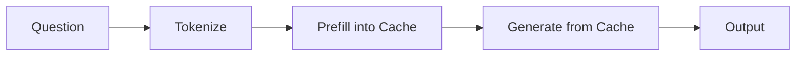
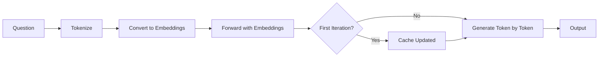

# Generation Flow: How Generation Works with Sliding Window Cache

This document explains the generation process using a cache filled by the sliding window approach, focusing on [`sampling_generation_function_sw`](file:///home/rforte/nas_home/OEM-VQA/ECCV/src/generation_sw.py).

## Overview

After filling the cache with thousands of video tokens, we need to generate an answer to a user question. The specialized SW generation function addresses a critical challenge:

> **Problem**: With 8753 cached tokens (mostly video) and only 50 question tokens, the question could get "buried" in attention patterns dominated by video content.

> **Solution**: Process the question as **fresh embeddings** instead of prefilling into cache, keeping it prominent in the attention mechanism.

## Architecture Comparison

### Standard Generation (for frame-by-frame)


### SW Generation (our approach)


**Key Difference**: Question goes through model as **embeddings** on first iteration, not as cached tokens.

---

## Function Breakdown

### Function Signature

```python
def sampling_generation_function_sw(
    model, 
    processor, 
    cache, 
    inputs, 
    max_new_tokens=128, 
    temperature=0.3, 
    top_p=0.9, 
    repetition_penalty=1.2
):
```

### Parameters
- **model**: The Qwen-VL model
- **processor**: Tokenizer/processor
- **cache**: Filled cache instance from `fill_cache_sw`
- **inputs**: Dictionary with `{"input_ids": question_tokens}`
- **max_new_tokens**: Maximum tokens to generate
- **temperature**: Sampling temperature (higher = more random)
- **top_p**: Nucleus sampling parameter
- **repetition_penalty**: Penalty for repeating tokens

---

## Initialization Phase (Lines 4-35)

### Lines 11-20: Setup
```python
decoded_sequence = ""
current_inputs_ids = inputs["input_ids"]
current_cache = cache
generated_token_ids = []
temperature = max(0.1, temperature)

if hasattr(cache, "global_token_counter"):
    current_global_step = cache.global_token_counter
else:
    current_global_step = cache.get_seq_length()
```

**Key variable**:
- `current_global_step`: Where we are in the absolute position sequence

**Example**:
```python
cache.global_token_counter  # 427,857 (from fill_cache_sw)
cache.get_seq_length()      # 8,753 (actual cached tokens)
```

We use `global_token_counter` for position IDs, not cache length!

### Lines 22-28: Token IDs and Debug Info
```python
im_end_id = processor.tokenizer.convert_tokens_to_ids("<|im_end|>")
eos_token_id = processor.tokenizer.eos_token_id

print(f"[GEN_SW] Starting generation with cache size: {current_cache.get_seq_length()} tokens")
print(f"[GEN_SW] Question length: {current_inputs_ids.shape[1]} tokens")
print(f"[GEN_SW] Temperature: {temperature}, top_p: {top_p}")
print(f"[GEN_SW] Strategy: Processing question as embeddings to avoid cache burial")
```

**Example output**:
```
[GEN_SW] Starting generation with cache size: 8753 tokens
[GEN_SW] Question length: 50 tokens
[GEN_SW] Temperature: 0.5, top_p: 0.9
[GEN_SW] Strategy: Processing question as embeddings to avoid cache burial
```

### Lines 30-35: Prepare Question Embeddings
```python
question_embeds = model.model.language_model.embed_tokens(current_inputs_ids)

first_iteration = True
```

**Critical step**: Convert question token IDs to embeddings immediately.

```python
current_inputs_ids.shape  # [1, 50]
question_embeds.shape     # [1, 50, 3584]
```

---

## Generation Loop (Lines 37-140)

### Loop Structure
```python
for i in range(max_new_tokens):
    with torch.no_grad():
        # ... generation logic
```

### First Iteration: Process Question (Lines 41-56)

```python
if first_iteration:
    # Use question embeddings for the first pass
    # Text-only input doesn't require special ROPE handling - no video grids involved
    current_seq_len = question_embeds.shape[1]  # 50
    attention_mask = torch.ones((1, physical_past_len + current_seq_len), device=model.device)
    position_ids = torch.arange(current_global_step, current_global_step + current_seq_len, device=model.device).unsqueeze(0)
    
    # Forward with embeddings (no rope_deltas needed for pure text)
    output = model.forward(
        inputs_embeds=question_embeds,
        past_key_values=current_cache,
        attention_mask=attention_mask,
        position_ids=position_ids,
        use_cache=True 
    )
    first_iteration = False
```

**What happens**:
1. **Prepare tensors**:
   ```python
   physical_past_len = 8753  # Cached tokens
   current_seq_len = 50      # Question length
   attention_mask.shape = [1, 8803]  # Can attend to all
   position_ids = [427857, 427858, ..., 427906]  # Continues from cache counter
   ```

2. **Forward pass**:
   - Question embeddings go through transformer layers
   - Attends to 8753 cached video tokens + 50 question tokens
   - **No ROPE deltas** needed - text doesn't require spatial position encoding

3. **Output**:
   ```python
   output.logits.shape        # [1, 50, vocab_size]
   output.past_key_values     # Updated cache (now contains question K/V too)
   ```

4. **Update state**:
   ```python
   current_cache = output.past_key_values
   first_iteration = False  # Switch to token-by-token mode
   ```

**Why embeddings instead of IDs?**
- Bypasses prefill cache expansion
- Keeps question tokens "fresh" in attention
- Prevents burial under 8753 video tokens

### Subsequent Iterations: Token-by-Token (Lines 57-69)

```python
else:
    # Subsequent iterations use token IDs (single token at a time)
    current_seq_len = current_inputs_ids.shape[1]  # Always 1
    attention_mask = torch.ones((1, physical_past_len + current_seq_len), device=model.device)
    position_ids = torch.arange(current_global_step, current_global_step + current_seq_len, device=model.device).unsqueeze(0)
    
    output = model.forward(
        input_ids=current_inputs_ids,
        past_key_values=current_cache,
        attention_mask=attention_mask,
        position_ids=position_ids,
        use_cache=True 
    )
```

**What happens**:
1. **Single token input**:
   ```python
   current_inputs_ids.shape  # [1, 1]  (e.g., token ID 1234)
   position_ids              # [427907]  (next position)
   ```

2. **Forward pass**:
   - One token embedded and processed
   - Attends to all cached tokens (video + question + previously generated)

3. **Update cache**:
   ```python
   current_cache = output.past_key_values  # Grows by 1 token each iteration
   ```

---

## Sampling Logic (Lines 71-132)

### Extract Logits (Line 71)
```python
logits = output.logits[:, -1, :]  # [1, vocab_size]
```

Take only the **last token's prediction** (for next token).

### Apply Repetition Penalty (Lines 73-91)
```python
if repetition_penalty != 1.0 and len(generated_token_ids) > 0:
    current_logits = logits[0]
    unique_seen = list(set(generated_token_ids))
    for token_id in unique_seen:
        if current_logits[token_id] < 0:
            current_logits[token_id] *= repetition_penalty
        else:
            current_logits[token_id] /= repetition_penalty
    logits[0] = current_logits
```

**Purpose**: Discourage repeating tokens already generated.

**Example**:
```python
generated_token_ids = [1234, 5678, 1234]  # Repeated 1234
unique_seen = [1234, 5678]

# Penalty for 1234:
logits[1234] = logits[1234] / 1.2  # Reduce probability
```

### Ban EOS Early (Lines 93-98)
```python
ban_eos_steps = 3
if i < ban_eos_steps:
    logits[:, eos_token_id] = -float('inf')
    if im_end_id is not None:
        logits[:, im_end_id] = -float('inf')
```

**Purpose**: Prevent premature ending in first 3 steps.

### Apply Temperature (Lines 100-102)
```python
logits = logits.float() / temperature
probs = F.softmax(logits, dim=-1)
```

**Effect**:
- Low temperature (e.g., 0.1) → sharper distribution (more deterministic)
- High temperature (e.g., 1.0) → flatter distribution (more random)

**Example**:
```python
# Original logits: [5.0, 3.0, 2.0]
# Temperature = 0.5:
logits_scaled = [10.0, 6.0, 4.0]  # Exaggerates differences
probs = softmax([10.0, 6.0, 4.0])  # → [0.88, 0.09, 0.03]

# Temperature = 2.0:
logits_scaled = [2.5, 1.5, 1.0]  # Smooths differences
probs = softmax([2.5, 1.5, 1.0])  # → [0.58, 0.25, 0.17]
```

### Apply Top-P (Nucleus) Sampling (Lines 104-119)
```python
if top_p < 1.0:
    sorted_probs, sorted_indices = torch.sort(probs, descending=True)
    cumulative_probs = torch.cumsum(sorted_probs, dim=-1)
    
    sorted_indices_to_remove = cumulative_probs > top_p
    sorted_indices_to_remove[..., 1:] = sorted_indices_to_remove[..., :-1].clone()
    sorted_indices_to_remove[..., 0] = 0
    
    indices_to_remove = sorted_indices_to_remove.scatter(1, sorted_indices, sorted_indices_to_remove)
    probs[indices_to_remove] = 0.0
    
    if probs.sum() == 0:
        probs = F.softmax(logits, dim=-1)
    else:
        probs = probs / probs.sum(dim=-1, keepdim=True)
```

**Purpose**: Keep only top tokens whose cumulative probability ≤ `top_p`.

**Example** with `top_p=0.9`:
```python
# Original probs (sorted):
# Token A: 0.5
# Token B: 0.3
# Token C: 0.15  ← Cumulative = 0.95 > 0.9, REMOVE
# Token D: 0.05  ← REMOVE

# After nucleus sampling:
# Token A: 0.625  (0.5 / 0.8)
# Token B: 0.375  (0.3 / 0.8)
# Token C: 0.0
# Token D: 0.0
```

### Sample Next Token (Line 121-122)
```python
next_token_index = torch.multinomial(probs, num_samples=1)
token_item = next_token_index.squeeze().item()
```

**Process**: Randomly sample according to probability distribution.

### Debug Output (Lines 124-128)
```python
if i < 5:
    top_probs, top_indices = torch.topk(probs[0], 5)
    top_tokens = [processor.tokenizer.decode([idx.item()]) for idx in top_indices]
    print(f"  [GEN_SW] Step {i}: token={processor.tokenizer.decode([token_item])} | Top 5: {list(zip(top_tokens, [f'{p:.3f}' for p in top_probs.tolist()]))}")
```

**Example output**:
```
[GEN_SW] Step 0: token=4 | Top 5: [('4', '1.000'), ('#', '0.000'), ('!', '0.000'), ('$', '0.000'), ('"', '0.000')]
[GEN_SW] Step 1: token=\n\n | Top 5: [('\n\n', '1.000'), ('#', '0.000'), ('!', '0.000'), ('$', '0.000'), ('"', '0.000')]
```

### Decode and Accumulate (Lines 130-132)
```python
decoded_token = processor.decode(token_item)
decoded_sequence += decoded_token
generated_token_ids.append(token_item)
```

### Update for Next Iteration (Lines 134-136)
```python
current_cache = output.past_key_values
current_inputs_ids = next_token_index
current_global_step += current_seq_len
```

**State update**:
```python
# First iteration:
current_global_step = 427857 + 50 = 427907

# Subsequent iterations:
current_global_step = 427907 + 1 = 427908
current_global_step = 427908 + 1 = 427909
# ...
```

### Early Stopping (Lines 138-140)
```python
if token_item == eos_token_id or token_item == im_end_id:
    print(f"[GEN_SW] Generation ended at step {i} with EOS token")
    break
```

---

## Finalization (Lines 142-144)

```python
print(f"[GEN_SW] Generated {len(generated_token_ids)} tokens: {decoded_sequence.strip()}")
cache.global_token_counter = current_global_step
return decoded_sequence
```

**Final state**:
```python
decoded_sequence  # "4\n\nI am in the kitchen\n<|im_end|>"
cache.global_token_counter  # Updated to 427915 (427907 + 8 generated tokens)
```

---

## Complete Example: Generating "4"

### Initial State
```python
cache.get_seq_length()      # 8753 tokens (video + system prompt)
cache.global_token_counter  # 427857
question = "Question: What room am I in? Options:\n1) Bedroom\n2) Bathroom\n3) Living room\n4) Kitchen\nReply with number only."
question_ids.shape          # [1, 50]
```

### Iteration 0: Process Question

**Forward**:
```python
inputs_embeds = question_embeds  # [1, 50, 3584]
position_ids = [427857, ..., 427906]
attention_mask.shape = [1, 8803]

output = model.forward(...)
logits.shape  # [1, 50, 150000]  (50 positions, vocab size 150k)
```

**Sample**:
```python
last_logits = logits[0, -1, :]  # Focus on last position
probs_top5 = {
    '4': 0.95,
    '3': 0.02,
    '2': 0.01,
    '1': 0.01,
    'Kitchen': 0.01
}
sampled_token = '4'  # Token ID 1851
```

**Update**:
```python
decoded_sequence = "4"
current_inputs_ids = [1851]
current_global_step = 427907
```

### Iteration 1: Generate Next Token

**Forward**:
```python
input_ids = [1851]  # Token '4'
position_ids = [427907]
attention_mask.shape = [1, 8804]  # Cache grew by 50 (question)

output = model.forward(...)
```

**Sample**:
```python
probs_top5 = {
    '\n\n': 0.80,
    '\n': 0.10,
    ' ': 0.05,
    '<|im_end|>': 0.03,
    '.': 0.02
}
sampled_token = '\n\n'  # Token ID 271
```

**Update**:
```python
decoded_sequence = "4\n\n"
current_global_step = 427908
```

### ... Continue until EOS ...

### Final Output
```python
decoded_sequence = "4\n\nI am in the kitchen\n<|im_end|>"
```

---

## Why This Approach Works

### Problem with Standard Generation
```python
# Standard approach:
cache = fill_cache(video)  # 8753 tokens of video
cache += question          # Add 50 question tokens
# Question buried in 8803 total tokens, 99.4% video!
```

**Attention pattern**:
```
Question tokens attend mostly to video tokens (8753/8803 = 99.4%)
→ Question context gets diluted
→ Model "forgets" what was asked
```

### Our SW Approach
```python
cache = fill_cache_sw(video)  # 8753 tokens
# DON'T add question to cache
# Pass question as fresh embeddings in first forward
```

**Attention pattern**:
```
Question embeddings attend to:
- Cached video (8753 tokens)
- Themselves (50 tokens)

But question stays "fresh" - not buried in cache
→ Model remembers what was asked
→ Better answers
```

---

## Common Issues

### Issue: High probability on single token
**Symptom**:
```
Top 5: [('4', '1.000'), ('#', '0.000'), ('!', '0.000'), ...]
```

**Cause**: Low temperature + top-p causing over-concentration

**Solution**: Increase temperature (0.5 → 1.0) or adjust top-p

### Issue: Repetitive output
**Symptom**: "4 4 4 4 4..."

**Cause**: Repetition penalty too low

**Solution**: Increase `repetition_penalty` to 1.5

### Issue: Gibberish output
**Symptom**: Non-sensical tokens

**Cause**: ROPE issues during cache filling or incorrect position IDs

**Solution**: Verify `global_token_counter` is correctly maintained

---

## Best Practices

1. **Always use fresh embeddings for questions** in SW mode
2. **Monitor top-5 probabilities** in first few steps - should be distributed
3. **Adjust temperature** based on task (0.1 for factual, 0.7 for creative)
4. **Ban EOS early** to prevent premature stopping
5. **Track global_token_counter** carefully - it drives position IDs

## Further Reading

- [Cache Filling Flow](file:///home/rforte/nas_home/OEM-VQA/ECCV/docs/sliding_window/cache_filling_flow.md) - How the cache is prepared
- [ROPE Explained](file:///home/rforte/nas_home/OEM-VQA/ECCV/docs/sliding_window/rope_explained.md) - Understanding position embeddings
