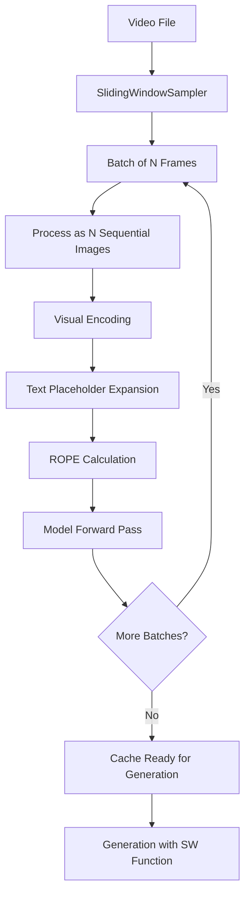

# Overview: Sliding Window Cache Filling Architecture

This document provides a high-level overview of the sliding window cache filling system.

## Architecture Diagram



## System Components

### 1. **Video Sampling Layer**
- **Component**: `SlidingWindowSampler` class
- **Purpose**: Breaks video into manageable windows
- **Output**: Batches of frame arrays

**Key Parameters**:
- `window_size`: Number of frames per batch (e.g., 20)
- `stride`: Frames to skip between windows (e.g., 10 for 50% overlap, or 20 for non-overlapping)
- `target_fps`: Target frames per second to sample

### 2. **Tensor Processing Layer**
- **Component**: Functions in `tensor_ops_sw.py`
- **Purpose**: Convert raw frames to model-compatible tensors
- **Key Operations**:
  1. Frame resizing and PIL conversion
  2. Visual encoding through vision transformer
  3. Projection to language model dimension
  4. Text placeholder expansion with image tokens

### 3. **Cache Filling Layer**
- **Component**: `fill_cache_sw()` function
- **Purpose**: Orchestrate the entire pipeline
- **Phases**:
  1. **Priming**: Initialize cache with system prompt
  2. **Batch Ingestion**: Process video windows sequentially
  3. **Cache Management**: Evict old tokens based on cache strategy

### 4. **Generation Layer**
- **Component**: `sampling_generation_function_sw()`
- **Purpose**: Generate answers using the filled cache
- **Strategy**: Process question as fresh embeddings to avoid burial in video-heavy cache

## Pipeline Flow: End-to-End

### Phase 1: Initialization
```python
# 1. Load system prompt
priming_conversation = [
    {"role": "system", "content": prompt},
    {"role": "user", "content": "Video stream starts now:"}
]

# 2. Create cache instance
cache_instance = CustomCache(config, K=total_capacity)

# 3. Prefill with system prompt
model.forward(inputs_embeds=priming_embeds, past_key_values=cache_instance)
```

### Phase 2: Video Ingestion Loop
For each batch from sampler:

```python
# 1. Convert frames to tensors
for frame in frames_batch:
    pil_image = resize_frame(frame)
    pixel_values, grid = process_pil_image(pil_image)
    
# 2. Encode visually
vision_embeddings = model.visual(combined_pixel_values, grid_thw)

# 3. Create N image placeholders
content = [{"type": "image"} for _ in range(len(frames_batch))]
input_ids = processor.apply_chat_template(content)

# 4. Expand placeholders
expanded_ids = expand_image_tokens(input_ids, num_vision_tokens)
embeddings = replace_placeholders(expanded_ids, vision_embeddings)

# 5. Calculate ROPE
rope_deltas = model.get_rope_index(expanded_ids, image_grid_thw)

# 6. Forward pass (adds to cache)
model.forward(
    inputs_embeds=embeddings,
    past_key_values=cache_instance,
    position_ids=position_ids,
    rope_deltas=rope_deltas
)
```

### Phase 3: Generation
```python
# 1. Prepare question
question_embeds = model.embed_tokens(question_input_ids)

# 2. Generate tokens iteratively
for i in range(max_new_tokens):
    output = model.forward(
        inputs_embeds=question_embeds,  # First iteration
        # OR input_ids=next_token,      # Subsequent iterations
        past_key_values=cache_instance,
        position_ids=position_ids
    )
    next_token = sample(output.logits)
```

## Key Design Decisions

### Why Sequence-of-Images Instead of Video Mode?

**Video Mode** (what we DON'T use):
```python
# All frames processed as one video tensor
inputs = processor.image_processor(images=all_frames)  # Single video
conversation = [{"role": "user", "content": [{"type": "video"}]}]
```

**Sequence-of-Images Mode** (what we DO use):
```python
# Each frame processed separately, concatenated
for frame in frames:
    pixel_values.append(process_pil_image(frame))
conversation = [{"role": "user", "content": [{"type": "image"}, {"type": "image"}, ...]}]
```

**Advantages**:
1. **Granular cache control**: Can evict specific frame tokens
2. **Flexible windowing**: Easy to implement sliding windows
3. **Position tracking**: Each image has distinct position IDs
4. **ROPE compatibility**: Standard image ROPE (no complex temporal ROPE)

### Why Separate Generation Function?

The standard generation function assumes the question is prefilled into cache. For SW:
- Cache is dominated by thousands of video tokens
- Question could get "buried" in attention
- Solution: Pass question as **embeddings** directly, keeping it "fresh"

## Performance Characteristics

### Memory Footprint
- **Cache size**: Fixed at `8753 tokens` (with StaticCache)
- **Per-batch overhead**: ~9000 tokens → evicted down to cache limit
- **Total VRAM**: Depends on model size + cache size

### Processing Speed
- **Batch ingestion**: ~0.1-0.3s per batch (20 frames)
- **Cache eviction**: Negligible overhead for most strategies
- **Generation**: ~0.05-0.1s per token

### Token Budget
Example from logs:
- System prompt: `561 tokens`
- Per batch: `~9008 tokens` (20 images × ~400 tokens each + placeholders)
- After eviction: Stays at `8753 tokens`
- Question: `50 tokens`
- **Total during generation**: 8753 (cache) + 50 (question) = 8803 tokens

## Common Issues & Solutions

### Issue 1: ROPE Deltas Mismatch
**Symptom**: Model generates nonsense or repeats tokens
**Cause**: ROPE calculated for wrong sequence length
**Solution**: Ensure `rope_deltas` matches `image_grid_thw` dimensions

### Issue 2: Position ID Discontinuity
**Symptom**: Generation ignores context
**Cause**: `global_token_counter` not tracked correctly
**Solution**: Update counter after each forward pass by `current_seq_len`

### Issue 3: Cache Overflow
**Symptom**: OOM errors during ingestion
**Cause**: Cache capacity too small for batch size
**Solution**: Increase `mutable_token_size` or reduce `dimention_sw`

## Next Steps

- [ROPE Explained](file:///home/rforte/nas_home/OEM-VQA/ECCV/docs/sliding_window/rope_explained.md) - Deep dive into rotary embeddings
- [Tensor Operations](file:///home/rforte/nas_home/OEM-VQA/ECCV/docs/sliding_window/tensor_ops_functions.md) - Function-by-function breakdown
- [Cache Filling Flow](file:///home/rforte/nas_home/OEM-VQA/ECCV/docs/sliding_window/cache_filling_flow.md) - Line-by-line walkthrough
