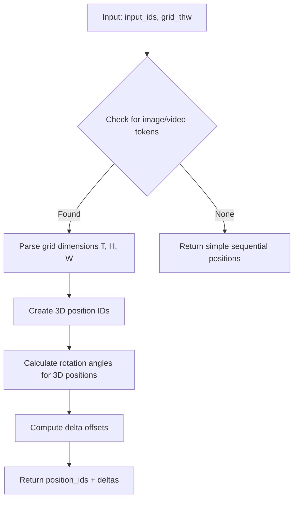

# ROPE Explained: Rotary Position Embeddings

This document provides an in-depth explanation of ROPE (Rotary Position Embeddings) and how they're used in vision-language models.

## What is ROPE?

ROPE (Rotary Position Embeddings) is a method for encoding positional information in transformer models using rotation matrices. Unlike absolute position embeddings, ROPE encodes **relative** positions.

### Core Concept

In transformer attention, we compute:
```
Attention(Q, K, V) = softmax(QK^T / √d) V
```

ROPE modifies Q and K by rotating them based on position:
```
Q_rotated = RoPE(Q, position)
K_rotated = RoPE(K, position)
Attention = softmax(Q_rotated @ K_rotated^T / √d) V
```

The rotation ensures that the dot product `Q_rotated @ K_rotated^T` encodes the **relative distance** between positions.

## ROPE in Qwen-VL Models

### Standard Text ROPE

For pure text, ROPE is straightforward:
```python
position_ids = [0, 1, 2, 3, 4, ...]  # Sequential positions
```

Each token gets rotated based on its absolute position, but the attention mechanism sees relative distances.

### Vision ROPE: The Challenge

For images/video, we need to encode **2D spatial positions** (height, width) and potentially **temporal positions** (time).

Qwen-VL uses a **3D grid representation**:
- **T** (Temporal): Time/frame index
- **H** (Height): Vertical position within frame  
- **W** (Width): Horizontal position within frame

### Grid THW Format

```python
grid_thw = torch.tensor([
    [T, H, W],  # For each image/video
])
```

Example for a single image at 896×512 resolution processed by ViT:
```python
grid_thw = [[1, 28, 16]]  # 1 frame, 28 height patches, 16 width patches
# Total tokens = 1 * 28 * 16 = 448 visual tokens
```

Example for a video with 20 frames:
```python
grid_thw = [[20, 28, 16]]  # 20 frames, same spatial resolution
# Total tokens = 20 * 28 * 16 = 8960 visual tokens
```

## ROPE Deltas: What Are They?

`rope_deltas` are **offsetting adjustments** to position IDs that account for special token arrangements.

### Why Do We Need Deltas?

Consider this input sequence:
```
[System] [Text1] <image_pad> <image_pad> ... <image_pad> [Text2]
```

The image tokens should have **2D/3D positional encoding** (from grid_thw), not simple sequential positions. ROPE deltas tell the model:
> "Hey, these tokens aren't sequential in the traditional sense; use the grid structure instead."

### How Deltas Work

From Qwen-VL's `get_rope_index`:
```python
def get_rope_index(
    input_ids,           # Token IDs with placeholders
    image_grid_thw,      # Grid dimensions for images
    video_grid_thw,      # Grid dimensions for videos
    attention_mask
):
    # Returns: (mrope_position_ids, mrope_position_deltas)
    ...
```

**Output**:
- `mrope_position_ids`: Modified position IDs for each token
- `mrope_position_deltas`: Delta adjustments to apply

### Example from Logs

```
rope_deltas shape: torch.Size([1, 1])
rope_deltas min/max: -8400/-8400
```

This delta of `-8400` means:
> "For these image tokens, shift the base position by -8400 to account for the 2D grid structure."

The actual implementation applies the delta to create 3D position coordinates:
```python
# Conceptually:
for image_token in range(num_image_tokens):
    h_pos = image_token // W
    w_pos = image_token % W
    t_pos = 0  # (for single image)
    
    # 3D position encoding
    position_3d = [t_pos, h_pos, w_pos]
```

## ROPE in Our Sliding Window Implementation

### During Cache Filling (`fill_cache_sw`)

For each batch of 20 frames processed as sequential images:

```python
# Step 1: Process 20 frames individually
batch_pixel_values = [process_pil_image(frame) for frame in frames_batch]
combined_pixel_values = torch.cat(batch_pixel_values, dim=0)
combined_grid_thw = torch.cat(batch_grid_thw, dim=0)
# combined_grid_thw shape: [20, 3] → 20 images, each with [1, H, W]

# Step 2: Create input with 20 image placeholders
conversation = [{"role": "user", "content": [{"type": "image"}, ...]}]  # 20 images
input_ids = processor.apply_chat_template(conversation)
# Results in: [role_tokens, <image_pad>, <image_pad>, ..., <image_pad>, role_tokens]

# Step 3: Expand placeholders
expanded_input_ids = expand_image_placeholders(input_ids, num_vision_tokens)
# Each <image_pad> becomes 448 tokens (for 896×512 image)

# Step 4: Calculate ROPE
_, rope_deltas = model.get_rope_index(
    input_ids=expanded_input_ids,
    image_grid_thw=combined_grid_thw,  # [20, 3]
    video_grid_thw=None,
    attention_mask=attention_mask
)

# Step 5: Forward with ROPE
model.forward(
    inputs_embeds=embeddings,
    position_ids=torch.arange(global_counter, global_counter + seq_len),
    rope_deltas=rope_deltas  # Applied internally
)
```

### Key Insight: Why Image Grid for Multiple Images?

We use `image_grid_thw` (not `video_grid_thw`) because we're treating each frame as a **separate image**, not as a continuous video sequence.

```python
# Our approach:
image_grid_thw = [
    [1, 28, 16],  # Frame 1
    [1, 28, 16],  # Frame 2
    ...
    [1, 28, 16],  # Frame 20
]

# What we DON'T do (video mode):
video_grid_thw = [[20, 28, 16]]  # All frames as one video
```

This gives us:
- Separate positional encoding for each frame
- Easier cache management (can identify frame boundaries)
- Flexibility for non-uniform frame processing

### During Generation (`generation_sw.py`)

For the **question** (text-only), we DON'T need special ROPE:

```python
# First iteration: Question embeddings
output = model.forward(
    inputs_embeds=question_embeds,
    position_ids=position_ids,
    # NO rope_deltas - pure text doesn't need grid-based positioning
)

# Subsequent iterations: Generated tokens
output = model.forward(
    input_ids=next_token,
    position_ids=position_ids,
    # NO rope_deltas - single token generation
)
```

**Why no deltas?**
- Question contains no images/videos
- Single tokens in generation are sequential
- ROPE automatically handles relative positions for text

## Common ROPE Issues

### Issue 1: Shape Mismatch

**Error**: `RuntimeError: shape mismatch in rope_deltas`

**Cause**: `image_grid_thw` doesn't match the number of image tokens in `input_ids`

**Fix**: Ensure expanded placeholders count equals `grid_thw.sum()` (total tokens across all grids)

```python
# Check:
total_grid_tokens = (grid_thw[:, 0] * grid_thw[:, 1] * grid_thw[:, 2]).sum()
assert total_image_tokens_in_input == total_grid_tokens
```

### Issue 2: Incorrect Delta Values

**Symptom**: Model attention collapses or ignores images

**Cause**: Using video ROPE for images or vice versa

**Fix**: Use `image_grid_thw` for separate images, `video_grid_thw` only for unified video tensors

### Issue 3: Missing ROPE in Generation

**Symptom**: Generated text is nonsensical

**Cause**: Incorrectly passing `rope_deltas` for text-only input

**Fix**: Only pass `rope_deltas` when forwarding image/video tokens, not for pure text

## ROPE Calculation Flow (Internal)

What happens inside `get_rope_index`:



### Simplified Mathematical View

For an image token at spatial position `(h, w)` in frame `t`:

```python
# 3D position
pos_3d = [t, h, w]

# ROPE angles (simplified)
theta_t = position_t / 10000^(2i/d)
theta_h = position_h / 10000^(2i/d)  
theta_w = position_w / 10000^(2i/d)

# Rotation matrix (conceptual)
R_rope = [
    [cos(theta_t), -sin(theta_t), 0, 0, ...],
    [sin(theta_t),  cos(theta_t), 0, 0, ...],
    [0, 0, cos(theta_h), -sin(theta_h), ...],
    [0, 0, sin(theta_h),  cos(theta_h), ...],
    # ... and for theta_w
]

# Applied to query/key vectors
Q_rotated = R_rope @ Q
K_rotated = R_rope @ K
```

The delta essentially adjusts which base position to start from.

## Best Practices

1. **Always provide grid_thw when processing images/videos**
   ```python
   _, rope_deltas = model.get_rope_index(
       input_ids=ids,
       image_grid_thw=grid,  # ← Don't skip this
       video_grid_thw=None,
       attention_mask=mask
   )
   ```

2. **Match grid to your processing mode**
   - Multiple separate images → `image_grid_thw` with multiple rows
   - Single unified video → `video_grid_thw` with one row

3. **Don't pass deltas for text-only**
   ```python
   # ✅ Correct
   output = model.forward(input_ids=text_ids, position_ids=pos_ids)
   
   # ❌ Wrong (unnecessary)
   output = model.forward(input_ids=text_ids, rope_deltas=deltas)
   ```

4. **Verify token counts**
   ```python
   expected_tokens = sum(t * h * w for t, h, w in grid_thw)
   actual_tokens = (input_ids == image_pad_id).sum()
   assert expected_tokens == actual_tokens
   ```

## Further Reading

- [RoFormer Paper](https://arxiv.org/abs/2104.09864) - Original ROPE proposal
- [Qwen-VL Technical Report](https://arxiv.org/abs/2308.12966) - Vision-language ROPE adaptation
- [Qwen3-VL Code](https://github.com/QwenLM/Qwen3-VL) - Implementation details
