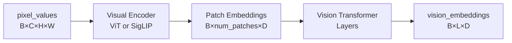

# Tensor Operations: Function-by-Function Reference

This document provides detailed documentation for each function in [`tensor_ops_sw.py`](file:///home/rforte/nas_home/OEM-VQA/ECCV/src/tensor_ops_sw.py).

## Table of Contents

1. [process_video_frames_sw](#process_video_frames_sw)
2. [compute_video_embeddings_sw](#compute_video_embeddings_sw)
3. [compute_projected_embeddings_sw](#compute_projected_embeddings_sw)
4. [compute_text_embeddings_sw](#compute_text_embeddings_sw)
5. [replace_video_placeholder_sw](#replace_video_placeholder_sw)

---

## `process_video_frames_sw`

### Signature
```python
def process_video_frames_sw(frames_batch, processor, device, size) -> tuple[torch.Tensor, torch.Tensor]
```

### Purpose
Converts a batch of raw numpy frames into model-compatible tensor format for **video processing**.

### Parameters
- **frames_batch** (`list[np.ndarray]`): List of video frames as numpy arrays (BGR format from OpenCV)
- **processor** (`Qwen2VLProcessor`): The model's processor for image/video handling
- **device** (`torch.device`): Target device (e.g., `cuda:0`)
- **size** (`tuple[int, int]`): Target resolution as `(width, height)`, e.g., `(896, 512)`

### Returns
- **pixel_values** (`torch.Tensor`): Processed pixel tensor in bfloat16, shape `[B, C, H, W]`
- **grid_thw** (`torch.Tensor`): Grid dimensions, shape `[1, 3]` as `[T, H, W]`

### Detailed Workflow

```python
def process_video_frames_sw(frames_batch, processor, device, size):
    from .utils import resize_video_frame
    from PIL import Image
    
    # Step 1: Resize each frame to target resolution
    processed_frames = []
    for frame in frames_batch:
        pil_image = resize_video_frame(frame, size)  # np.array → PIL.Image
        processed_frames.append(pil_image)
    
    # Step 2: Process as video (temporal sequence)
    # The processor treats list of images as video frames
    inputs = processor.image_processor(images=processed_frames, return_tensors="pt")
    inputs = inputs.to(device)
    
    # Step 3: Extract tensors
    pixel_values = inputs.pixel_values.to(torch.bfloat16)  # [B, C, H, W]
    grid_thw = inputs.image_grid_thw                        # [1, 3] → [T, H, W]
    
    return pixel_values, grid_thw
```

### Important Notes

> **⚠️ Currently NOT Used**: This function processes frames as a **unified video**, but `fill_cache_sw` uses the **sequence-of-images** approach instead. See [design decision](file:///home/rforte/nas_home/OEM-VQA/ECCV/docs/sliding_window/overview.md#why-sequence-of-images-instead-of-video-mode).

### Example Usage

```python
# Hypothetical usage (not actually used in current implementation)
sampler = SlidingWindowSampler(video_path, window_size=20, stride=10)
for frames_batch in sampler:
    pixel_values, grid_thw = process_video_frames_sw(
        frames_batch, processor, device, size=(896, 512)
    )
    # grid_thw = [[20, 28, 16]]  → 20 frames, 28×16 spatial patches
```

---

## `compute_video_embeddings_sw`

### Signature
```python
def compute_video_embeddings_sw(pixel_values, model, grid_thw=None) -> tuple[torch.Tensor, int]
```

### Purpose
Extracts visual embeddings from pixel tensors using the model's vision encoder.

### Parameters
- **pixel_values** (`torch.Tensor`): Processed pixels, shape `[B, C, H, W]`
- **model** (`Qwen2VLForConditionalGeneration`): The vision-language model
- **grid_thw** (`torch.Tensor`, optional): Grid configuration for vision encoder

### Returns
- **vision_embeddings** (`torch.Tensor`): Visual embeddings, shape `[B, L, D]` where:
  - `B` = batch size
  - `L` = number of visual tokens
  - `D` = embedding dimension
- **num_vision_tokens** (`int`): Total number of visual tokens (`B * L`)

### Detailed Workflow

```python
def compute_video_embeddings_sw(pixel_values, model, grid_thw=None):
    # Step 1: Pass through visual encoder
    vision_output = model.model.visual(pixel_values, grid_thw=grid_thw)
    
    # Step 2: Extract embeddings (handle different output formats)
    if hasattr(vision_output, 'last_hidden_state'):
        vision_embeddings = vision_output.last_hidden_state
    elif isinstance(vision_output, tuple):
        vision_embeddings = vision_output[0]
    else:
        vision_embeddings = vision_output
    
    # Step 3: Ensure 3D shape [B, L, D]
    if len(vision_embeddings.shape) == 3:
        num_vision_tokens = vision_embeddings.size(0) * vision_embeddings.size(1)
    elif len(vision_embeddings.shape) == 2:
        vision_embeddings = vision_embeddings.unsqueeze(0)
        num_vision_tokens = vision_embeddings.size(1)
    else:
        num_vision_tokens = vision_embeddings.size(1) if vision_embeddings.size(1) > 0 else 1
    
    return vision_embeddings, num_vision_tokens
```

### Visual Encoder Architecture



### Example

```python
# From 20 images at 896×512
pixel_values.shape  # [20, 3, 512, 896]

vision_embeddings, num_tokens = compute_video_embeddings_sw(
    pixel_values, model, grid_thw=grid_thw
)

vision_embeddings.shape  # [20, 448, 3584]  (20 images, 448 patches each, 3584-dim)
num_tokens              # 8960 = 20 × 448
```

---

## `compute_projected_embeddings_sw`

### Signature
```python
def compute_projected_embeddings_sw(vision_embeddings) -> torch.Tensor
```

### Purpose
Reshapes/projects vision embeddings to match language model's expected input format.

### Parameters
- **vision_embeddings** (`torch.Tensor`): Raw vision embeddings from encoder

### Returns
- **projected_vision_embeddings** (`torch.Tensor`): Reshaped to `[1, total_tokens, D]`

### Detailed Workflow

```python
def compute_projected_embeddings_sw(vision_embeddings):
    # Flatten batch dimension into sequence dimension
    if len(vision_embeddings.shape) == 3:
        # [B, L, D] → [1, B*L, D]
        projected_vision_embeddings = vision_embeddings.view(1, -1, vision_embeddings.size(2))
    elif len(vision_embeddings.shape) == 2:
        # [L, D] → [1, L, D]
        projected_vision_embeddings = vision_embeddings.unsqueeze(0)
    else:
        # Already [1, L, D]
        projected_vision_embeddings = vision_embeddings
    
    return projected_vision_embeddings
```

### Why This Matters

The language model expects inputs in batch format `[1, seq_len, dim]`. Vision embeddings come in various shapes depending on processing mode:
- Single image: `[448, 3584]`
- Batch of images: `[20, 448, 3584]`

This function normalizes all to `[1, total_tokens, 3584]` for consistency.

### Example

```python
vision_embeddings.shape       # [20, 448, 3584]
projected = compute_projected_embeddings_sw(vision_embeddings)
projected.shape               # [1, 8960, 3584]
```

---

## `compute_text_embeddings_sw`

### Signature
```python
def compute_text_embeddings_sw(input_ids, num_vision_tokens, processor, model) -> tuple[torch.Tensor, torch.Tensor]
```

### Purpose
Expands `<|image_pad|>` placeholder tokens in text to accommodate vision tokens, then computes embeddings.

### Parameters
- **input_ids** (`torch.Tensor`): Tokenized input with placeholders, shape `[1, L]`
- **num_vision_tokens** (`int`): Total number of vision tokens to insert
- **processor** (`Qwen2VLProcessor`): For token ID lookups
- **model**: The model (for embedding layer access)

### Returns
- **text_embeddings** (`torch.Tensor`): Text embeddings with expanded placeholders, shape `[1, expanded_L, D]`
- **expanded_input_ids** (`torch.Tensor`): Expanded token IDs, shape `[1, expanded_L]`

### Detailed Workflow

```python
def compute_text_embeddings_sw(input_ids, num_vision_tokens, processor, model):
    # Step 1: Get placeholder token ID
    visual_token_id = processor.tokenizer.convert_tokens_to_ids('<|image_pad|>')
    
    # Step 2: Find placeholder positions
    placeholder_indices = torch.where(input_ids[0] == visual_token_id)[0]
    
    if len(placeholder_indices) == 0:
        # No placeholders → return as-is
        return model.model.language_model.embed_tokens(input_ids), input_ids
    
    # Step 3: Calculate tokens per placeholder
    tokens_per_placeholder = num_vision_tokens // len(placeholder_indices)
    
    # Step 4: Expand each placeholder
    new_input_ids = []
    last_idx = 0
    for idx in placeholder_indices:
        # Add tokens before placeholder
        new_input_ids.append(input_ids[0, last_idx:idx])
        # Expand placeholder to tokens_per_placeholder copies
        new_input_ids.append(
            torch.full((tokens_per_placeholder,), visual_token_id, device=input_ids.device)
        )
        last_idx = idx + 1
    # Add remaining tokens
    new_input_ids.append(input_ids[0, last_idx:])
    
    # Step 5: Concatenate
    expanded_input_ids = torch.cat(new_input_ids).unsqueeze(0)
    
    # Step 6: Embed
    text_embeddings = model.model.language_model.embed_tokens(expanded_input_ids)
    
    return text_embeddings, expanded_input_ids
```

### Visual Example

**Input**:
```python
input_ids = [role, <img_pad>, <img_pad>, ..., <img_pad>, role_end]  # 20 placeholders
num_vision_tokens = 8960  # 20 images × 448 tokens
```

**Process**:
```
tokens_per_placeholder = 8960 / 20 = 448

Before:  [role, <img_pad>, <img_pad>, ..., role_end]
After:   [role, <pad>×448, <pad>×448, ..., role_end]
         └─────────────────────────────────┘
         8960 placeholder tokens total
```

**Output**:
```python
expanded_input_ids.shape  # [1, 8980]  (20 + 8960 + some role tokens)
text_embeddings.shape     # [1, 8980, 3584]
```

### Important Notes

> The expanded placeholders will be **replaced** with actual vision embeddings in the next step. At this stage, they're just embedding lookups for the `<|image_pad|>` token.

---

## `replace_video_placeholder_sw`

### Signature
```python
def replace_video_placeholder_sw(input_ids, text_embeddings, projected_vision_embeddings, processor) -> torch.Tensor
```

### Purpose
Replaces `<|image_pad|>` token embeddings with actual vision embeddings.

### Parameters
- **input_ids** (`torch.Tensor`): Expanded input IDs with placeholders
- **text_embeddings** (`torch.Tensor`): Text embeddings (with placeholder embeddings)
- **projected_vision_embeddings** (`torch.Tensor`): Actual vision embeddings to insert
- **processor**: For token ID lookup

### Returns
- **input_embeddings** (`torch.Tensor`): Final multimodal embeddings with vision content

### Detailed Workflow

```python
def replace_video_placeholder_sw(input_ids, text_embeddings, projected_vision_embeddings, processor):
    # Step 1: Find placeholder positions
    visual_token_id = processor.tokenizer.convert_tokens_to_ids('<|image_pad|>')
    placeholder_indices = torch.where(input_ids[0] == visual_token_id)[0]
    
    if len(placeholder_indices) == 0:
        return text_embeddings  # No placeholders
    
    # Step 2: Clone text embeddings
    input_embeddings = text_embeddings.clone()
    
    # Step 3: Replace placeholders with vision embeddings
    num_vision_tokens = projected_vision_embeddings.shape[1]
    
    if len(placeholder_indices) != num_vision_tokens:
        # Mismatch → take minimum
        min_tokens = min(len(placeholder_indices), num_vision_tokens)
        input_embeddings[0, placeholder_indices[:min_tokens]] = projected_vision_embeddings[0, :min_tokens]
    else:
        # Exact match
        input_embeddings[0, placeholder_indices] = projected_vision_embeddings[0]
    
    return input_embeddings
```

### Visual Representation

```
Before replacement:
text_embeddings = [role_emb, pad_emb, pad_emb, ..., pad_emb, role_end_emb]
                            └───────────────────┘
                            8960 placeholder embeddings

After replacement:
input_embeddings = [role_emb, vis1, vis2, ..., vis8960, role_end_emb]
                             └────────────────────┘
                             Actual vision embeddings
```

### Example

```python
# Input shapes
text_embeddings.shape               # [1, 8980, 3584]
projected_vision_embeddings.shape   # [1, 8960, 3584]

# Find placeholders
placeholder_indices.shape           # [8960]  (8960 <image_pad> tokens)

# Replace at those indices
input_embeddings = replace_video_placeholder_sw(...)
input_embeddings.shape              # [1, 8980, 3584]  (same shape, different content)

# Verify replacement
assert (input_embeddings[0, placeholder_indices] == projected_vision_embeddings[0]).all()
```

### Critical Detail

The replacement is **in-place at specific indices**, not concatenation:
- ❌ Not: `[text] + [vision] + [text]` (concatenation)
- ✅ Instead: `[text, vision@indices, text]` (replacement)

This preserves the exact sequence structure expected by the model's chat template.

---

## Function Call Order in `fill_cache_sw`

Here's how these functions are called in sequence:

```python
# For each batch of frames:
for frames_batch in sampler:
    # ========== STANDARD TENSOR OPS (from tensor_ops.py) ==========
    # We actually use these instead of _sw versions:
    
    # 1. Process individual frames as images
    batch_pixel_values = []
    batch_grid_thw = []
    for frame in frames_batch:
        pil_image = resize_video_frame(frame, size)
        pv, _, grid = process_pil_image(pil_image, processor, device)
        batch_pixel_values.append(pv)
        batch_grid_thw.append(grid)
    
    combined_pixel_values = torch.cat(batch_pixel_values, dim=0)
    combined_grid_thw = torch.cat(batch_grid_thw, dim=0)
    
    # 2. Compute vision embeddings
    vision_embeddings, total_vision_tokens = compute_visual_embeddings(
        combined_pixel_values, model, grid_thw=combined_grid_thw
    )
    
    # 3. Project embeddings
    projected_vision_embeddings = compute_projected_embeddings(vision_embeddings)
    
    # 4. Create conversation with N image placeholders
    content_list = [{"type": "image"} for _ in range(len(frames_batch))]
    conversation = [{"role": "user", "content": content_list}]
    
    # 5. Tokenize and expand
    input_ids_initial = process_text_conversation(conversation, processor, device)
    text_embeddings, expanded_input_ids = compute_text_embeddings(
        input_ids_initial, total_vision_tokens, processor, model
    )
    
    # 6. Replace placeholders
    input_embeddings = replace_placeholder(
        expanded_input_ids, text_embeddings, projected_vision_embeddings, processor
    )
    
    # 7. Calculate ROPE
    _, rope_deltas = model.model.get_rope_index(
        input_ids=expanded_input_ids,
        image_grid_thw=combined_grid_thw,
        video_grid_thw=None,
        attention_mask=attention_mask
    )
    
    # 8. Forward pass
    model.forward(
        inputs_embeds=input_embeddings,
        past_key_values=cache_instance,
        position_ids=position_ids,
        rope_deltas=rope_deltas
    )
```

## Summary Table

| Function | Input | Output | Purpose |
|----------|-------|--------|---------|
| `process_video_frames_sw` | Raw frames | `(pixel_values, grid_thw)` | Convert frames to video tensor |
| `compute_video_embeddings_sw` | Pixel tensor | `(vision_embeds, num_tokens)` | Extract visual features |
| `compute_projected_embeddings_sw` | Vision embeds | Projected embeds | Reshape for LM |
| `compute_text_embeddings_sw` | Input IDs | `(text_embeds, expanded_ids)` | Expand placeholders |
| `replace_video_placeholder_sw` | Embeds + vision | Final embeds | Merge vision into text |

## Next Steps

- [Cache Filling Flow](file:///home/rforte/nas_home/OEM-VQA/ECCV/docs/sliding_window/cache_filling_flow.md) - See these functions in context
- [ROPE Explained](file:///home/rforte/nas_home/OEM-VQA/ECCV/docs/sliding_window/rope_explained.md) - Understand the ROPE calculations
